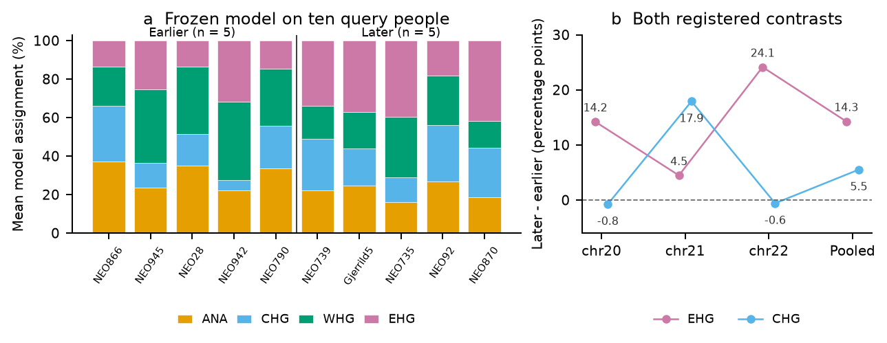
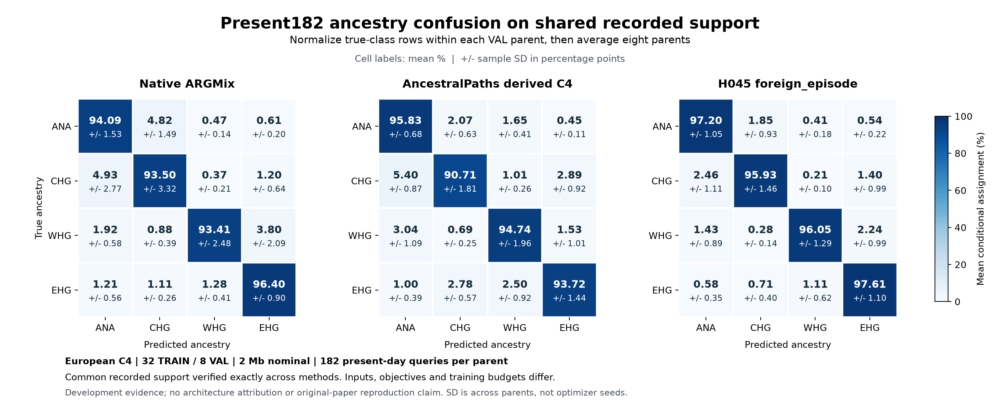
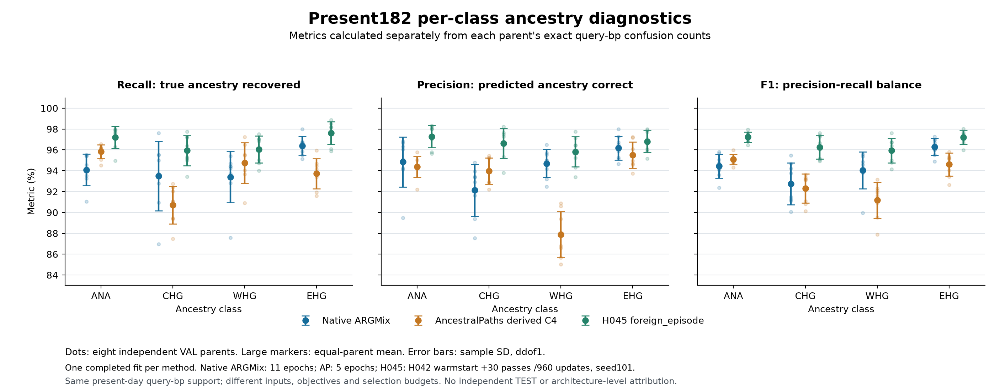
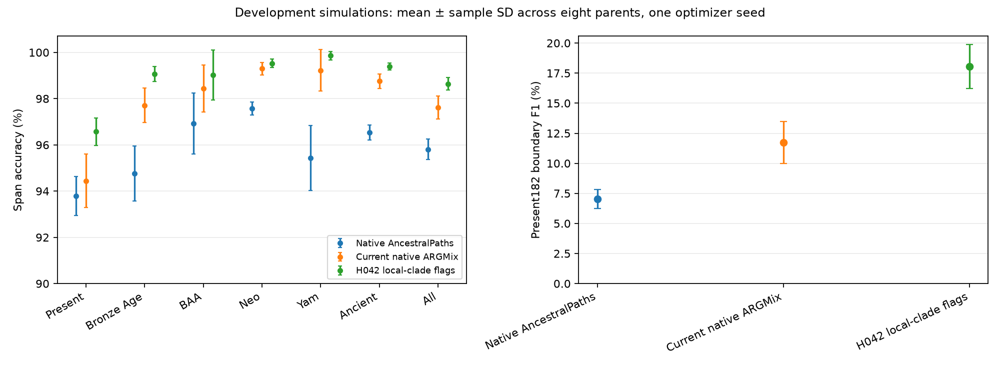
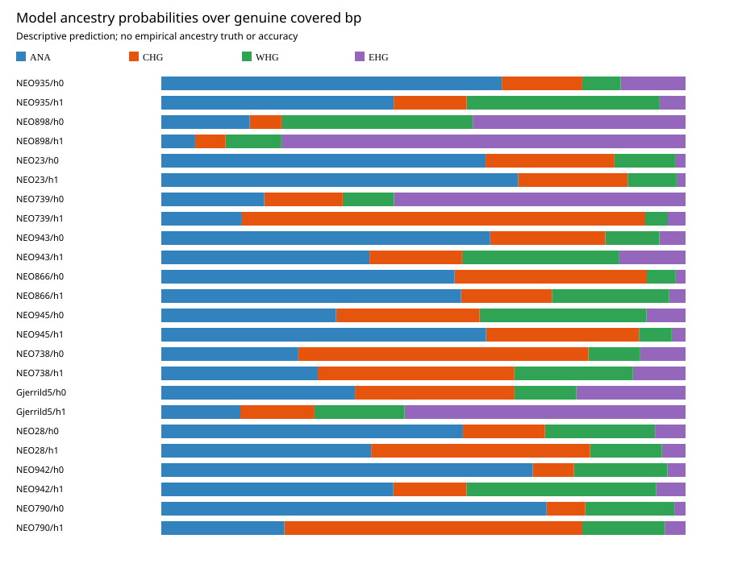
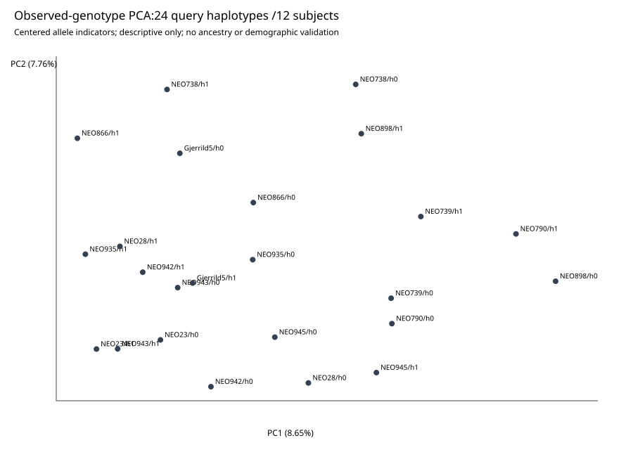

# ARG-GNN

Graph neural networks for ordered collections of whole genealogical trees, with local ancestry inference from ancestral recombination graphs as the main application. The manuscript uses the AAAI template.

## Latest status

[Persistent research goal and reporting requirements](research/goal_current.json). Current limits: **physical GPU 0 only**, parallel jobs allowed, and **1 TB** of storage. All project writes stay inside this server repository. GPUs 4–5 are excluded.

[Concise progress and remaining paper requirements](research/progress_current.md).

**Latest completed European development result:** stable-leaf memory reaches **97.0778 ± 0.5674%**, versus **97.0000 ± 0.4978%** for same-budget continuation. Boundary F1 falls from 19.0488% to 18.3807%. The higher-order triple-support mechanism fails both registered utility criteria. These are eight reused validation simulations, one seed. [Four-arm results and interpretation](research/reviews/H050_completed_comparison_root_20261016_v1/REPORT.md).

<!-- CURRENT_SCOREBOARD_START -->
**Scoreboard updated UTC: 2026-10-16T09:55:03.101207+00:00.** [Every current setup, all cohorts and detailed metrics](research/current_scoreboard.md) · [Native class metrics and training-lineage audit, frozen17-setup snapshot](research/reviews/root_score_report_20261015_v1/REPORT.md) · [All recorded historical/engineering metric receipts](research/all_recorded_metric_receipts.md)

| Current run | Device | Progress | Validation score |
|---|---:|---|---|
| American TRAIN preparation | CPU | 20/20 inferred 2 Mb TRAIN parents ready. Exact 10k-focal plans: 20/20 completed; controlled continuation uses at most two CPU producers. | no ancestry score |
| Original American VAL000 | CPU | Full 30 Mb simulation, inference and 10k-focal/native-path preparation completed. Same 600 references and 1,000 queries. | predictions pending |
| Original American VAL001–004 | CPU | 001/simulate: completed; actual wait0 and owned-group drain verified; 001/infer: completed; actual wait0 and owned-group drain verified; 001/native_paths: completed; actual wait0 and owned-group drain verified; 002/simulate: completed; actual wait0 and owned-group drain verified; 002/infer: completed; actual wait0 and owned-group drain verified. Original VAL002 pre-admission import failure preserved; corrected project-root import environment authorized and root launch issued. Original parent session92429 returned1 after successful simulate/close; fresh same-science inference admission recovered, original failure preserved | no ancestry score |
| Native ARGformer | GPU0 | Native American ARGformer has no completed optimizer update or ancestry score. The prior GPU0 route failed before training because of inherited GPU eligibility checks. A fresh operational successor fixes the source route and is under independent review. It will run after the current C3 controller finishes, within GPU0 memory limits. Author numerical training and the original failure remain unchanged. | pending |
| Native ARGformer held-out VAL000 | CPU | Original per-ARG six-dataset counts: completed; actual wait0 and owned drain verified. Separate native fit follows actual counts. | no ancestry score |
| Native FLARE | CPU | Completed fixed native-call score on one VAL parent, not a multi-parent paper-table reproduction. Macro F1 97.7151%. Author build, TRAIN000 full-site inference and prediction seal completed. Held-out VAL000 conversion: completed; actual wait0 and owned-group drain verified; native inference: completed; actual wait0 and owned-group drain verified; seal: prediction worker completed; direct wait0 and owned-group drain verified, outer tool terminal/final guard unconfirmed. | 98.0100% focal accuracy |
| Our American C3 GNN | GPU0 | 20/20 exact TRAIN plans completed. C3 is training on physical GPU 0 after all 20 TRAIN observation banks completed. At least 147/600 optimizer updates are verified, including 47 after retained checkpoint 100. Latest progress receipts do not assert a new durable optimizer checkpoint. No American GNN ancestry score. Original VAL000 full-length GNN block plan: completed; actual wait0 and owned drain verified. | no ancestry score |
| H049 cut-memory candidate | CPU preparation | bounded-v5 CPU preparation completed with genuine wait0/drain. Three matched 32,446-parameter arms. Full 30 passes / 960 updates per arm planned. | no fit or accuracy yet |
| H050 stronger direct-readout candidate | CPU evaluation complete | All four arms completed 30 passes and 960 new FP32 updates per arm, 3,840 new updates total. CPU evaluation completed all 192 prediction seals before any VAL truth, with genuine outer tool exit 0. Original TRAIN CLI exit 1 remains recorded. Primary utility failed, secondary boundary utility failed. Eight reused development VAL simulations, seed101, no independent test. H045 own-state predictor retained initially, three 32,325-parameter memory arms and a 31,812-parameter continuation. 192 prediction seals verified, original GPU0 TRAIN CLI exit 1 preserved. | triple_support_pair_memory 97.0640 ± 0.5595%, adjacent_marginal_null 97.0504 ± 0.5796%, stable_leaf_memory 97.0778 ± 0.5674%, h045_continued_training 97.0000 ± 0.4978% |
| Empirical data | CPU | H045 probabilities, ancestry proportions and genotype PCA completed for 24 query haplotypes / 12 subjects. Descriptive only, without known ancestry truth. | completed |

**Completed H048:** 96.3800 ± 0.6002% graph_to_transition; 96.3886 ± 0.6098% graph_to_own_confidence_fixed_distance_chain. Both registered utility criteria failed. [Actual scores, all cohorts and provenance](research/reviews/H048_completed_comparison_root_20261015_v1/REPORT.md).

**Current measured development scores:** H045 foreign-episode **96.8270 ± 0.5870%** Present182 span accuracy, matched own-state **96.8175 ± 0.6142%**. H046: 96.7892 ± 0.6042% foreign_flank; 96.7776 ± 0.6351% own_state. H046 foreign-flank minus own-state Present182 accuracy gain +0.011573 ± 0.069124 percentage points (sample SD of paired differences across eight VAL parents). Mean boundary F1 difference +0.149225 percentage points. The registered utility rule failed: at least +0.10 accuracy points and at most 1.00 point mean boundary F1 loss. Both selected checkpoints are original pass 30; one optimizer seed. This is reused development validation, not independent test or novelty evidence. H047 original-risk **96.7777 ± 0.5970%**, balanced-risk **96.7576 ± 0.5287%**. SD is across eight VAL simulations, one optimizer seed. H048: 96.3800 ± 0.6002% graph_to_transition; 96.3886 ± 0.6098% graph_to_own_confidence_fixed_distance_chain. H050: triple_support_pair_memory 97.0640 ± 0.5595%, adjacent_marginal_null 97.0504 ± 0.5796%, stable_leaf_memory 97.0778 ± 0.5674%, h045_continued_training 97.0000 ± 0.4978%. [All 23 measured setups, all seven cohorts, NLL/F1/boundaries/Brier/ECE and training budgets](research/current_scoreboard.md#detailed-cohort-metrics).

[Fresh independent H048 novelty/cross-domain assessment](research/reviews/H048_novelty_crossdomain_fresh_20261015_v1/report.md). Fresh independent H048 audit: reset transitions have RFMix precedent; a distinct graph-collection operator is unestablished. GST reaction-center sets have no native chain order, so whole-H048 transfer is not justified. PKU-MMD is only a possible future decoder study after native label-overlap semantics are resolved; no transfer result exists.

**ARGformer paper fidelity:** ARGformer Table1 reports PCA10/clustering and nearest-reference retrieval as separate classifiers. The exact PCA cluster/mapping evaluator remains unavailable. We retain the unchanged author-release head_norm/top1 retrieval as a disclosed common-data reconstruction. No native ancestry score is available yet. [Audit](research/reviews/ARGformer_Table1_downstream_resolution_20261016_v1/RESOLUTION.md).

**Biological comparison scope:** Our current AncestralPaths comparator is the released Dense workflow with derived four-source probability collapse. Native six-path ancestry and BAA-excluded four-path retraining are distinct endpoints. [Exact labels, cohorts and protocol differences](docs/biological_comparison_scope.md).

**Remaining biological error:** H045 recovers22.59% of true Present182 changes at1kb tolerance despite96.827% span accuracy. Across8VAL parents its selected predictions match905 changes, miss3103 and add5063extra calls. [Audited residual-error table and scope limits](research/reviews/residual_biological_errors_20261015_v1/REPORT.md).

**Comparison contract:** Use the same observed genomes, reference/query identities, truth and scored support. Each method keeps its native representation, such as VCFs, ancestral paths or PyG tensors. Extra inputs, training changes and reconstruction differences are disclosed. Native-format differences do not postpone a shared-data comparison.

**Next ARGMix comparison, not yet run:** A prospective 1,611-diploid paired panel with explicit reference/query roles. The official HapMapII GRCh37 chr22 map has been acquired and the generator map contract passed. Simulation and model comparison remain pending. This is a new common-data comparison, distinct from the unavailable original-table inputs. [Frozen plan and remaining adapters](research/reviews/ARGMix_published_panel_fair_comparison_source_plan_20261016_v1/HANDOFF.md).

**Paper readiness:** The compiled eleven-page AAAI draft now includes H050, its matched controls and the first native American FLARE score. It is not submission-ready. Complete American ARGformer/FLARE/GNN comparisons, a larger ARGMix comparison, independent held-out confirmation, useful operator novelty and stronger biological corroboration remain unfinished. The completed learned TGB comparison found no higher-order benefit. [Current H050 results and remaining scope](research/reviews/H050_completed_comparison_root_20261016_v1/REPORT.md) · [Draft scope](paper/README.md).

**Danish biological corroboration:** Completed GP-only Danish corroboration over all three fixed windows, 14432 common-support SNPs. Pooled f4: -0.00223403, -0.00460966. Descriptive genotype affinity only, without independent ancestry truth or model accuracy. Neither prespecified positive-direction hypothesis was supported. [Actual results and limits](research/reviews/H055_root_actual_CPU_20261016_v1/REPORT.md).

**Current GPU policy: physical GPU0 only.** Our GPU4/5 jobs have stopped and their contexts/known roots are absent. Parallel jobs onGPU0 are permitted after fresh device-bound admission. [Policy and actual stop evidence](research/reviews/GPU0_only_user_transition_root_20261016_v1/GPU0_only_policy.root_active_v1.json).

**GST and cross-domain status:** Only the saved TRAIN 1000/VALID 1495, seed 0 CPU pilot is scored: four models, AdamW lr=0.001, weight_decay=0.0001, batch=16, 20 epochs/1260 updates per fit. Full TRAIN has 10439/10500 retained reactions; this count is data readiness, not a fit. The full-data multi-seed fit is inactive and unfinished. Our molecular adapter and native paired TEST comparison remain unfinished; TEST withheld. GST inputs are unordered reactant sets with no native chain order, so whole-H048 transfer is not justified.

**TGB ordered cross-domain diagnostic:** Native persistence TEST NDCG@10 0.8469±0.0144, EMA-window7 0.8090±0.0049. SD across3 serially dependent target years2014–2016,675country-years. Unchanged native classes with disclosed forecast-before-current-year-edge release and1986initialization. This causal protocol is distinct from the published leaderboard. Completed all3models x100epochs/100updates,300totalupdates. TEST NDCG@10: first_order0.83238±0.01125, conditional_triple0.83045±0.01101, tree_only0.82706±0.01134; native persistence0.84688±0.01439. Conditional-triple is below first-order on VAL and TEST, so this condition does not support the mechanism. SD spans3dependent TEST years, one optimizerseed. Additional seeds declined from VAL before TEST release. [Actual training status](research/TGB_H051_current_training_status.json). [Frozen protocol and actual per-year results](research/current_scoreboard.md#tgb-annual-trade-causal-diagnostic).

**Ordered-tree mechanism status:** The frozen TRAIN-only trade audit found 22 partition changes and 21 nonzero conditional-innovation years. This establishes active input support, without a predictive-accuracy result. [Actual audit](research/reviews/TGB_trade_H051_data_integration_root_20261016_v1/actual_TRAIN_operator_support.root_v1.json). A [fresh independent literature review](research/reviews/H051_independent_priority_audit_20261016_v2/REPORT.md) identifies established conditional-mean and higher-order constructions. Generic operator novelty remains unestablished.

**Frozen Danish model application:** Frozen H045 application completed on all three Danish chromosomes and all ten query people, with zero optimization. Pooled later-minus-earlier model assignments: EHG +14.27 pp, CHG +5.52 pp. EHG is positive on all three chromosomes. CHG depends on chromosome 21 and reverses when it is omitted. Actual tool 42438 consumed exit 0. Descriptive outputs without ancestry truth or mixture calibration. H055 negative genotype contrasts remain counterevidence. [Actual progress](research/reviews/H056_actual_progress_root_20261016_v1/status.root_latest.json).

Parallel ownership: workers completed source and independent reviews for the native ARGMix route, saved-fit H050 evaluator and C3 handover. Root owns GPU0 execution, actual outcomes, metrics and Git.

<!-- CURRENT_SCOREBOARD_END -->

[Current11-page AAAI working PDF](paper/current_full_panel_working.pdf) · [LaTeX source](paper/current_full_panel_working.tex) · [Overleaf working bundle](paper/current_full_panel_overleaf_working.zip). Compiled and visually checked on 2026-10-16, now including completed H050, its matched controls and the first American native FLARE score. This is a development draft with unfinished scientific validation.

**Best measured development result:** H050 stable-leaf memory reaches **97.0778 ± 0.5674% Present182 span accuracy**, versus **97.0000 ± 0.4978%** for same-budget continued training. Each arm completed 30 additional FP32 passes and 960 updates. The 0.0778 percentage-point difference comes with lower boundary F1, 18.3807% versus 19.0488%. Triple-support fails both registered utility criteria. These results do not establish useful higher-order novelty. [Completed four-arm comparison](research/reviews/H050_completed_comparison_root_20261016_v1/REPORT.md).

Current native ARGMix reaches **94.4461 ± 1.1491%** on the shared development panel. SNP inputs, training budget and checkpoint selection differ, so this pipeline comparison does not isolate architecture or reproduce published tables. H044 written scores remain verified, with genuine post-completion CLI exit 1 preserved. [H044 results and caveat](research/reviews/H044_completed_comparison_root_20261015_v1/README.md).

The shared model backbone combines **whole-tree PyTorch Geometric message passing, observed SNP features, exact local topology-change flags and a bidirectional GRU across genomic trees**. H042 has 30,788 parameters. H044 adds a 640-parameter marker readout, for 31,428 total. Neither uses ARGMix predictions. Whole trees, all 952 observed haplotypes and the full genomic recurrent history are retained.

**Class-level error analysis:** [Three-way confusion maps and paired recall differences](research/reviews/development_confusion_20261016_v1/REPORT.md). On the same eight Present182 VAL simulations, H045 minus current ARGMix mean class recall is +3.11 pp ANA, +2.43 pp CHG, +2.64 pp WHG and +1.20 pp EHG. These are descriptive reductions of existing selected development metrics, with per-parent normalization and paired simulation SDs. They do not establish an independent test gain or architecture-only attribution.

### TRAIN-only resolution diagnostic

Across 32 TRAIN simulations, the native tree readout oracle reaches 99.8920 ± 0.0100% Present182 accuracy. The original 100 bp grid oracle reaches 99.9965 ± 0.0002%, a paired gap of +0.1044 ± 0.0098 percentage points. This narrowly meets the registered 0.10 pp gate and shows limited resolution headroom. **These are oracle ceilings, not trained model scores.** No VAL or outer data or model predictions were read. [All seven cohorts, original support, actual completion and interpretation](research/reviews/H057_completed_TRAIN_resolution_audit_root_20261016_v1/REPORT.md).

### Paper completion status

The compiled eleven-page AAAI draft is **not submission-ready**. No overall top-1 claim is supported. H050 stable-leaf memory leads current development accuracy at97.0778%,but the higher-order mechanism failed its registered utility criteria.

| Required evidence | Current status |
|---|---|
| European shared development | Completed for our candidates, current author ARGMix and released AncestralPaths with a disclosed C4 readout. Common support, population metrics and confusion diagnostics are available. |
| ARGMix published-scale experiments | Unfinished. The paper-scale 1,611-diploid panel has not been simulated and scored. Published-table reproduction is unproved. |
| American ARGformer / FLARE / our GNN | Partial. Native FLARE VAL000 scored 98.0100% accuracy and 97.7151% macro F1 on 10,000 common focal records, one parent. Our GNN is training on GPU0 with at least 147/600 updates. Native ARGformer and remaining common multi-parent scores are unfinished. |
| Independent European test and uncertainty | Unfinished. Eight reserved outer simulations are ungenerated and untouched. Current headline SD is across validation simulations with one training seed. |
| Useful distinct architecture | Unproved. H045 foreign-minus-own accuracy is only 0.0096 pp. H050 matched memory/readout candidates completed training and evaluation. Both higher-order utility criteria failed. |
| Biological and cross-domain evidence | Partial. Descriptive real-data predictions/PCA exist. Danish genotype contrasts did not support either registered direction. Frozen Danish model application is complete as a descriptive study. Paired GST TEST remains unfinished. The completed TGB diagnostic does not support a higher-order memory gain. |

[Detailed current scores and all seven cohorts](research/current_scoreboard.md) · [Existing development confusion figures](research/reviews/development_confusion_20261016_v1/REPORT.md)

### Frozen model on the fixed Danish cohort

The frozen H045 checkpoint completed on all ten query people and three chromosome windows. Later-minus-earlier model assignments are **EHG +14.27 pp** and **CHG +5.52 pp**. CHG reverses when chromosome 21 is omitted. These are descriptive probabilities without empirical ancestry accuracy or calibrated mixture fractions. The prior negative GP-affinity contrasts remain counterevidence.

[Complete result, sensitivity and scope](research/reviews/H056_completed_model_application_root_20261016_v1/REPORT.md) · [Independent interpretation](research/reviews/H056_actual_outcome_interpretation_20261016_v1/REPORT.md)

### Shared-data development comparison

The panel contains 476 diploids, 686 queries and 266 proxies over 2 Mb. All 32 independent TRAIN and eight VAL simulations, native Relate post-size inference and observation banks completed. Eight reserved outer simulations remain ungenerated and untouched. SD below is across the eight VAL simulations, with one optimizer seed per model. It is not training-seed uncertainty.

| Pipeline | Present182 accuracy, mean ± SD (%) | Mean NLL | Boundary F1 at1kb (%) |
|---|---:|---:|---:|
| H050 stable_leaf_memory | 97.0778 ± 0.5674 | 0.088115 ± 0.021993 | 18.3807 ± 1.3141 |
| H050 triple_support_pair_memory | 97.0640 ± 0.5595 | 0.088471 ± 0.020998 | 18.9265 ± 1.4187 |
| H050 adjacent_marginal_null | 97.0504 ± 0.5796 | 0.088394 ± 0.021768 | 18.8498 ± 1.0520 |
| H050 h045_continued_training | 97.0000 ± 0.4978 | 0.088541 ± 0.019128 | 19.0488 ± 1.4275 |
| H045 foreign_episode | 96.8270 ± 0.5870 | 0.092980 ± 0.020423 | 18.1558 ± 1.3790 |
| H045 own_state | 96.8175 ± 0.6142 | 0.092976 ± 0.020230 | 18.0557 ± 1.7761 |
| H044 localized | 96.7919 ± 0.5967 | 0.094944 ± 0.020882 | 15.5374 ± 1.1777 |
| H046 foreign_flank | 96.7892 ± 0.6042 | 0.094685 ± 0.020530 | 17.4847 ± 1.7741 |
| H044 tree_pooled | 96.7866 ± 0.6161 | 0.094962 ± 0.021065 | 18.6750 ± 1.2687 |
| H047 original_risk | 96.7777 ± 0.5970 | 0.094808 ± 0.020849 | 18.2775 ± 1.7493 |
| H046 own_state | 96.7776 ± 0.6351 | 0.094792 ± 0.021067 | 17.3354 ± 1.6777 |
| H047 balanced_risk | 96.7576 ± 0.5287 | 0.096819 ± 0.021357 | 18.5574 ± 1.7800 |
| H042 exact local-clade flags | 96.5778 ± 0.5954 | 0.100656 ± 0.020069 | 18.0451 ± 1.8423 |
| H043 true_partner | 96.5182 ± 0.6201 | 0.101527 ± 0.019742 | 17.4301 ± 1.3301 |
| H043 own_state | 96.5029 ± 0.6006 | 0.101819 ± 0.019255 | 17.1055 ± 0.7889 |
| H048 graph_to_own_confidence_fixed_distance_chain | 96.3886 ± 0.6098 | 0.137125 ± 0.029011 | 16.7423 ± 1.8672 |
| H048 graph_to_transition | 96.3800 ± 0.6002 | 0.303922 ± 0.058599 | 16.6695 ± 1.5616 |
| H040 tensor | 96.2674 ± 0.7493 | 0.109332 ± 0.021073 | 16.1986 ± 2.0270 |
| H040 event_mlp | 96.2007 ± 0.7048 | 0.110014 ± 0.020489 | 16.1312 ± 1.6911 |
| H038 aligned whole-tree PyG | 95.4891 ± 0.8338 | 0.133497 ± 0.026419 | 13.4195 ± 1.4686 |
| H038 zero-concordance control | 94.9252 ± 0.7917 | 0.147232 ± 0.023024 | 11.7904 ± 1.3304 |
| Current native ARGMix | 94.4461 ± 1.1491 | 0.219695 ± 0.023975 | 11.7372 ± 1.7328 |
| Native AncestralPaths derived C4 | 93.7830 ± 0.8385 | ∞ | 7.0281 ± 0.7779 |

H040 and H042 start from the same H038 checkpoint and each complete 30 additional FP32 passes/960 whole-parent updates. H042 beats the tensor layer by 0.3104 pp at the same added budget and parameter count. Tensor coupling beats its matched event MLP by only 0.0667 pp, positive in 6/8 simulations. The local-clade control is strongest among these H040/H042 variants. These results do not establish new-layer novelty.

ARGMix retains the current author implementation and native early stopping, ending after 11 epochs. AncestralPaths retains the author Dense512 model and fixed five-epoch fit on 5,190,874 sampled rows. Its six-path probabilities are collapsed to four source classes before argmax, with native six-path SNP-focal scores retained separately. Our checkpoint uses validation accuracy selection. All pipelines use common physical-span C4 scoring support, but our GNN additionally consumes observed SNPs. Earlier README text incorrectly called this full-panel genealogy tsinfer/tsdate because reused helper modules carry that name.

*Strict raw FP32 AncestralPaths NLL is infinite because one parent assigns zero probability to a true class over 800 query-base pairs. No probability floor or recalibration is applied.*

[H042 completed comparison](research/reviews/H042_completed_comparison_root_20261015_v1/README.md) · [H040 matched comparison](research/reviews/H040_completed_comparison_root_20261015_v1/README.md) · [Native ARGMix score and transcript](research/reviews/expanded_native_argmix_H038_score_root_v1/readonly_CPU_result_v1.json) · [AncestralPaths receipts](experiments/results/full_panel_H038_AP_comparison_root/summary.json)

### Population and tract-boundary metrics

[Current matched comparison figures and metric provenance](research/reviews/current_comparison_figures_20261015_v1/cohort_score_table.md).

| Setup | Present182 | BronzeAge162 | BAA14 | Neo302 | Yam26 | Ancient504 | All686 |
|---|---:|---:|---:|---:|---:|---:|---:|
| H050 stable_leaf_memory | 97.0778 ± 0.5674 | 99.1611 ± 0.4329 | 99.3453 ± 1.0446 | 99.7335 ± 0.0682 | 99.9366 ± 0.1229 | 99.5492 ± 0.1257 | 98.8935 ± 0.2345 |
| H050 triple_support_pair_memory | 97.0640 ± 0.5595 | 99.1356 ± 0.4344 | 99.2933 ± 1.0707 | 99.7168 ± 0.0805 | 99.9366 ± 0.1254 | 99.5296 ± 0.1380 | 98.8755 ± 0.2375 |
| H050 adjacent_marginal_null | 97.0504 ± 0.5796 | 99.1319 ± 0.4194 | 99.3567 ± 0.9636 | 99.6999 ± 0.0771 | 99.9355 ± 0.1261 | 99.5199 ± 0.1347 | 98.8647 ± 0.2428 |
| H050 h045_continued_training | 97.0000 ± 0.4978 | 99.1360 ± 0.4040 | 99.2531 ± 1.0425 | 99.6468 ± 0.0595 | 99.9072 ± 0.1399 | 99.4851 ± 0.1335 | 98.8258 ± 0.2215 |
| H045 foreign_episode | 96.8270 ± 0.5870 | 99.2047 ± 0.3199 | 99.1511 ± 1.2545 | 99.6063 ± 0.0850 | 99.9039 ± 0.1292 | 99.4799 ± 0.1347 | 98.7761 ± 0.2486 |
| H045 own_state | 96.8175 ± 0.6142 | 99.1658 ± 0.3983 | 99.2765 ± 1.1385 | 99.6424 ± 0.0859 | 99.8687 ± 0.1833 | 99.4907 ± 0.1501 | 98.7815 ± 0.2566 |
| H044 localized | 96.7919 ± 0.5967 | 99.1895 ± 0.3391 | 99.2328 ± 1.1873 | 99.6288 ± 0.0928 | 99.8685 ± 0.2092 | 99.4889 ± 0.1358 | 98.7734 ± 0.2475 |
| H046 foreign_flank | 96.7892 ± 0.6042 | 99.1902 ± 0.3478 | 99.2822 ± 1.0786 | 99.6347 ± 0.0975 | 99.8489 ± 0.2268 | 99.4931 ± 0.1417 | 98.7757 ± 0.2533 |
| H044 tree_pooled | 96.7866 ± 0.6161 | 99.1900 ± 0.3386 | 99.2662 ± 1.0684 | 99.6324 ± 0.0993 | 99.8593 ± 0.2264 | 99.4917 ± 0.1384 | 98.7740 ± 0.2550 |
| H047 original_risk | 96.7777 ± 0.5970 | 99.1860 ± 0.3514 | 99.2947 ± 1.0733 | 99.6369 ± 0.0956 | 99.8433 ± 0.2268 | 99.4931 ± 0.1426 | 98.7727 ± 0.2516 |
| H046 own_state | 96.7776 ± 0.6351 | 99.1850 ± 0.3438 | 99.2615 ± 1.1370 | 99.6278 ± 0.0919 | 99.8644 ± 0.2082 | 99.4875 ± 0.1368 | 98.7685 ± 0.2572 |
| H047 balanced_risk | 96.7576 ± 0.5287 | 99.1282 ± 0.3234 | 99.3747 ± 0.6939 | 99.5660 ± 0.0872 | 99.8167 ± 0.2111 | 99.4329 ± 0.1213 | 98.7231 ± 0.2210 |
| H042 exact local-clade flags | 96.5778 ± 0.5954 | 99.0748 ± 0.3242 | 99.0226 ± 1.0723 | 99.5291 ± 0.1771 | 99.8569 ± 0.1871 | 99.3859 ± 0.1560 | 98.6409 ± 0.2641 |
| H043 true_partner | 96.5182 ± 0.6201 | 98.9949 ± 0.3463 | 99.1731 ± 1.0093 | 99.5198 ± 0.1912 | 99.8251 ± 0.2007 | 99.3572 ± 0.1652 | 98.6040 ± 0.2688 |
| H043 own_state | 96.5029 ± 0.6006 | 99.0107 ± 0.3257 | 99.1048 ± 0.9583 | 99.5217 ± 0.1935 | 99.8547 ± 0.1785 | 99.3630 ± 0.1737 | 98.6042 ± 0.2691 |
| H048 graph_to_own_confidence_fixed_distance_chain | 96.3886 ± 0.6098 | 98.8716 ± 0.4962 | 99.0846 ± 1.1561 | 99.6338 ± 0.0734 | 99.6818 ± 0.3024 | 99.3760 ± 0.1971 | 98.5834 ± 0.3006 |
| H048 graph_to_transition | 96.3800 ± 0.6002 | 98.8686 ± 0.4981 | 99.0791 ± 0.8563 | 99.4847 ± 0.2192 | 99.6233 ± 0.5314 | 99.2826 ± 0.2593 | 98.5125 ± 0.3421 |
| H040 tensor | 96.2674 ± 0.7493 | 98.8266 ± 0.4696 | 99.1439 ± 0.8901 | 99.5200 ± 0.1579 | 99.7215 ± 0.3045 | 99.2971 ± 0.2073 | 98.4933 ± 0.3390 |
| H040 event_mlp | 96.2007 ± 0.7048 | 98.8238 ± 0.4377 | 99.1147 ± 0.9216 | 99.5576 ± 0.1232 | 99.7569 ± 0.2389 | 99.3197 ± 0.1707 | 98.4922 ± 0.2948 |
| H038 aligned whole-tree PyG | 95.4891 ± 0.8338 | 98.1726 ± 0.8000 | 98.9020 ± 0.8854 | 99.4103 ± 0.1271 | 98.9598 ± 1.3143 | 98.9751 ± 0.3226 | 98.0503 ± 0.4312 |
| H038 zero-concordance control | 94.9252 ± 0.7917 | 98.4120 ± 0.5405 | 98.6137 ± 0.9470 | 99.1716 ± 0.2703 | 99.4215 ± 0.8073 | 98.9248 ± 0.2837 | 97.8637 ± 0.3727 |
| Current native ARGMix | 94.4461 ± 1.1491 | 97.7051 ± 0.7466 | 98.4370 ± 1.0186 | 99.2955 ± 0.2623 | 99.2218 ± 0.8966 | 98.7566 ± 0.3114 | 97.6130 ± 0.4975 |
| Native AncestralPaths derived C4 | 93.7830 ± 0.8385 | 94.7589 ± 1.1847 | 96.9352 ± 1.3195 | 97.5693 ± 0.2748 | 95.4303 ± 1.4096 | 96.5380 ± 0.3194 | 95.8071 ± 0.4473 |

H042 has higher mean span accuracy than native AP and current native ARGMix in all seven cohorts. This does not imply a win on every simulation or metric. Bronze Age is an approximate correspondence to the paper's Post-Neolithic category, not a verified identical panel. These rows cannot be compared directly with its published Tables 1/2.

Present182 boundary F1 at 1 kb tolerance is **18.05 ± 1.84%** for H042, **13.42 ± 1.47%** for H038, **11.74 ± 1.73%** for current native ARGMix and **7.03 ± 0.78%** for native AncestralPaths. H042 precision is 15.21 ± 2.01% and recall 22.30 ± 1.86%. Boundary inference remains weak despite high span accuracy. The fixed H038 diagnostic finds about 27.3% of true changes have no allowed native-hold edge within 1 kb, motivating a finer readout. H044 localized continuation scores **15.54 ± 1.18%** and its tree-pooled control **18.67 ± 1.27%**. The localized head has worse boundary F1 despite its slightly higher span accuracy. H044 includes another 30 training passes, so gains versus H042 do not isolate the readout.

[H042 cohort/boundary summaries](research/reviews/H042_completed_cohort_diagnostics_root_20261015_v1/README.md) · [Native class/confusion diagnostics](research/reviews/native_common_cohort_diagnostics_20261015_v1/diagnostic_report.md) · [Fixed-output boundary analysis](research/reviews/H038_boundary_error_diagnostic_source_v1/biological_conclusions.md)

### Running and next experiments

**H048, GPU4:** GPU4 TRAIN and VAL completed; both registered utility criteria failed. 30/30 completed passes; {'graph_to_own_confidence_fixed_distance_chain': 960, 'graph_to_transition': 960} verified update lower bounds. Validation: 96.3800 ± 0.6002% graph_to_transition; 96.3886 ± 0.6098% graph_to_own_confidence_fixed_distance_chain. Both registered utility criteria failed. Fixed budget:30 FP32 passes and960 updates per arm. [Registered evaluation route](research/reviews/H048_evaluate_root_handoff_20261015_v1/HANDOFF.md).

**Native ARGformer, GPU0:** Native American ARGformer has no completed optimizer update or ancestry score. The prior GPU0 route failed before training because of inherited GPU eligibility checks. A fresh operational successor fixes the source route and is under independent review. It will run after the current C3 controller finishes, within GPU0 memory limits. Author numerical training and the original failure remain unchanged.

**Native FLARE:** Author build and TRAIN000 full-site conversion completed with actual wait0. Native inference: completed; actual wait0 and owned-group drain verified; sealing: completed; actual wait0 and owned-group drain verified. Native completed allowance closed; 8977226240 unused bytes credited with all files preserved. Accuracy pending; TRAIN000 is development, not held-out. Held-out VAL000 conversion: completed; actual wait0 and owned-group drain verified.

**Original remaining American VAL:** 001/simulate: completed; actual wait0 and owned-group drain verified; 001/infer: completed; actual wait0 and owned-group drain verified; 001/native_paths: completed; actual wait0 and owned-group drain verified; 002/simulate: completed; actual wait0 and owned-group drain verified; 002/infer: completed; actual wait0 and owned-group drain verified. Original VAL002 pre-admission import failure preserved; corrected project-root import environment authorized and root launch issued. Original parent session92429 returned1 after successful simulate/close; fresh same-science inference admission recovered, original failure preserved.

**H050 saved-fit CPU evaluation:** All four arms completed 30 passes and 960 new FP32 updates per arm, 3,840 new updates total. CPU evaluation completed all 192 prediction seals before any VAL truth, with genuine outer tool exit 0. Original TRAIN CLI exit 1 remains recorded. Primary utility failed, secondary boundary utility failed. Eight reused development VAL simulations, seed101, no independent test. Present182: triple_support_pair_memory 97.0640 ± 0.5595%, adjacent_marginal_null 97.0504 ± 0.5796%, stable_leaf_memory 97.0778 ± 0.5674%, h045_continued_training 97.0000 ± 0.4978%. [All four arms, seven cohorts and paired utility](research/current_scoreboard.md#h050-matched-direct-readout-outcome).

**Completed H046:** H046 foreign-flank minus own-state Present182 accuracy gain +0.011573 ± 0.069124 percentage points (sample SD of paired differences across eight VAL parents). Mean boundary F1 difference +0.149225 percentage points. The registered utility rule failed: at least +0.10 accuracy points and at most 1.00 point mean boundary F1 loss. Both selected checkpoints are original pass 30; one optimizer seed. This is reused development validation, not independent test or novelty evidence. [Results](research/reviews/H046_completed_comparison_root_20261015_v1/REPORT.md).

**Completed H047:** original-risk96.7777±0.5970%, balanced-risk96.7576±0.5287%. Both30passes/960updates. Registered accuracy benefit not met. [Results](research/reviews/H047_completed_comparison_root_20261015_v1/REPORT.md).

**American GNN preparation:** remaining TRAIN001–013 fanout 5/13 completed with actual wait0; terminal failed_or_stopped_partial_preserved; root requested cooperative stop of new additions to relieve GPU training mutex contention, current scientific children drain unchanged. Fresh controlled TRAIN006–015 continuation 10/10 completed with genuine wait0; max2CPU producers; terminal completed_selected_remaining_exact_focal_plan_preparations. run016_017_v1: 2/2 genuine completed waits; completed_selected_remaining_exact_focal_plan_preparations. run018_v1: 1/1 genuine completed waits; completed_selected_remaining_exact_focal_plan_preparations. run019_v1: 1/1 genuine completed waits; completed_selected_remaining_exact_focal_plan_preparations. All20/20 original inferred2Mb TRAIN inputs completed with genuine workerwait0/drain. Final019 recovery has genuine durable remotePopenwait0 and helpercompletion0. Original parent terminal1 and independentSSH255 transportfailure remain recorded. Exact focalplan readiness is reported separately. At most two wave parents. C3 is training on physical GPU 0 after all 20 TRAIN observation banks completed. At least 147/600 optimizer updates are verified, including 47 after retained checkpoint 100. Latest progress receipts do not assert a new durable optimizer checkpoint. No American GNN ancestry score..

**Architecture work:** H049 sample-witness order-2 cut memory is implemented and registered with matched null/leaf-memory controls. bounded-v5 CPU preparation completed with genuine wait0/drain. Predictive utility and a distinct new contribution remain unproved. [Design and prior-art limits](research/reviews/ordered_graph_operator_research_20261015_v1/REPORT.md).

Root orchestrates execution and publishing. Three workers handle full prospective1611 generation, shared-run evaluation integration, and operator novelty/scaling in parallel. Only physical GPU0 is eligible for future experiments, with process title AI Auto Research Pipeline Test. Historical GPU4/5 attempts are stopped.

### Original-paper and empirical validation

**The original benchmarks remain unfinished.** ARGMix's paper uses 1,611 diploids and excludes BAA. ARGformer reports an American EUR/EAS/AFR benchmark. Neither is numerically reproduced by the European development results above. There is no current evidence of top-1 performance across the supplied papers.

| Benchmark | Completed evidence | What is still needed |
| --- | --- | --- |
| European common-input development panel | Native AP, current native ARGMix and our GNN on eight shared VAL simulations, population SDs and confusion/boundary diagnostics | Independent test confirmation and training-seed variation |
| ARGMix published Tables 1 and 2 | Primary-source protocol and published values audited | Published-panel IID and misspecification experiments. Paper-era code and recipe details remain unavailable |
| ARGformer American Table 1 | Full30Mb TRAIN and VAL000 simulated/inferred inputs and native paths completed. Native MLM status: Native American ARGformer has no completed optimizer update or ancestry score. The prior GPU0 route failed before training because of inherited GPU eligibility checks. A fresh operational successor fixes the source route and is under independent review. It will run after the current C3 controller finishes, within GPU0 memory limits. Author numerical training and the original failure remain unchanged.. FLARE TRAIN000 calls sealed. | Finish native per-target fits, original remaining VAL001–004, all matched predictions and common EUR/EAS/AFR metrics. Exact Table1 downstream settings remain unresolved |
| Empirical ancestry and PCA | H045 predictions, bp-weighted proportions and original-genotype PCA completed for24query haplotypes/12subjects on the355-tree,2074-site panel | Descriptive biological/domain assessment. No known empirical truth or accuracy |

ARGformer uses node tokens specific to each ARG. Each independent target ARG needs its own native vocabulary, unsupervised pretraining and reference-only fit, with query ancestry truth withheld. Our GNN uses a separate supervised TRAIN split. Evaluation must use the same target observations, reference/query identities and scoring support for both pipelines.

The American data are a disclosed reconstruction with 1,600 explicitly haploid samples and a 12-generation pulse, not an exact ARGformer Table 1 reproduction. 19/20 independent2Mb TRAIN inferred inputs and18/20 exact focal plans are complete. Final TRAIN019 inference admission is under repair after actual parent supervisor terminal1. The complete label-blind count found 25,574,587 unique paths, 316,672,003 tokens and maximum raw path length 29. The independently reviewed v3 preparation completed in 18.6 minutes with genuine wait 0 and all native paths, six raw corpus files, vocabulary, seed-42 splits and original focal identities retained. Its peak owned RSS was 42.2 GB. Preparation is not model training or a C3 accuracy result. Native model fits and C3 scores remain unfinished. [Full-corpus completion](experiments/results/American_C3_native_paths_train000_full30mb_seed92001_v3/completed.json) · [Genuine supervisor wait](research/reviews/American_C3_native_paths_root_v3/admitted_native_paths_train000_full30mb_v3/actual_wait.json) · [Independent review](research/reviews/American_C3_native_paths_v3_independent_review_20261015_v1/assessment.md).

The original real-data region failed its fixed 1,000-site gate with 217/13,312 passing sites. The prospectively registered 10 Mb extension now passes unchanged QC with **2,074/94,892 sites**, and acquisition completed with actual wait 0. No genealogy inference, model application, real-data ancestry accuracy or PCA result is claimed from acquisition alone. Its timing records attribute 1,632 of 1,669 worker seconds to repeated storage checks, motivating batched artifacts in the next pipeline.

An audit of the actual frozen QC tables corrected a doubled upstream counter: the original region has **217** passing sites, and the extension has **2,074**. Earlier acquisition reports said 434 and 4,148. The 1,000-site gate results and exact site masks are unchanged. The bridge also assumed textual Booleans although the writer emits 0/1. Its failed preparation is retained. The corrected adapter completed on CPU with genuine worker/root exit 0. Independent parsing verifies all 2,074 written sites against the original genotypes, including biological nucleotides, phase, sample/date order and map. All 277 monomorphic sites are retained. All eight split native qualification stages now return 0, including Finalize and conversion. The original v4 controller returned 1 because the internal-date verifier rounded branches prematurely. A one-line exact-oracle correction now passes every fact on the preserved outputs, resolving all 39 mismatches without rerunning native stages or changing outputs. Original exit 1 remains recorded. The observed native commands have now all completed with exit 0, yielding 355 trees and valid dates/topology/support. Its original strict export check fails at 198 sites, affecting 692 of 82,960 nucleotide cells. Every constant site passes. Native approximate mapping and converter flip/multibranch handling explain the discrepancy. The strict gate remains failed. A separately recorded graph-only/original-genotype interface now verifies the graph inputs while retaining the exact observed genotype matrix independently, matching the simulation TRAIN reader. It excludes the converted mutation tables from SNP features. The variable-panel adapter and H045 empirical application have completed, with ancestry probabilities, bp-weighted proportions and genotype PCA for24query haplotypes/12subjects. These are descriptive outputs without known ancestry truth. Panel/domain assessment remains necessary. [Completed application](experiments/results/H018_H045_empirical_application_root_v1/completed.json). [Graph-only contract](research/reviews/H018_observed2074_native_inference_source_v2/graph_only_observation_contract_root_v1/README.md).

The real-data regional map is now qualified: 12,280 rows preserve all 12,278 interior public-map knots and span 23.12908 cM. Forty sample-date entries retain the original calibrated BP1950/28 convention. All output hashes and dates were verified after an outer controller logging failure, whose unknown child exit remains recorded without a wait-0 claim. No empirical genealogy or model result follows from these metadata. [Qualified map and dates](research/reviews/H018_genealogy_next_source_v1/root_metadata_stage_basis_v1/completed.json) · [Controller caveat and output verification](research/reviews/H018_metadata_root_execution_20261015_v1/root_result_validation_after_control_failure.json).

The author-code GST TRAIN1000 pilot completed. Full native TRAIN parsing now retains **10,439/10,500 reactions**, containing **364,213 atoms**, with the original 61 drops and no fatal errors. The full native 20-epoch budget is **13,060 updates per fit**. The existing CPU runtime supports a future full-data/five-seed extension. No new full-data GST fit has started. Our molecular graph-collection adapter and paired TEST comparison remain unfinished. [Full TRAIN coverage](research/reviews/GST_full_TRAIN_count_root_v1/README.md) · [Earlier readiness assessment](research/reviews/GST_training_readiness_20261015_v1/READINESS.md)

[ARGMix protocol audit](docs/argmix_published_benchmark_audit_v1.md) · [ARGformer protocol audit](docs/argformer_published_benchmark_audit_v1.md) · [Real-data contract](docs/real_data_validation_plan_v1.md)

**Efficiency:** the H038 training path aggregates exact target spans by native tree interval, retaining every tree/query/GRU state. First full-parent updates took about 1.8 seconds with approximately 24 GB Torch reserved-memory peak. Later 32-parent passes took about 44 seconds. These are H038 training measurements, separate from preparation and evaluation. H044 requires original-grid supervision because its predictions vary within trees.

**Research success criteria:** faithful shared-data and original-paper comparisons, separately justified novelty, useful empirical biology, a cross-domain test and an auditable AAAI manuscript. All experiment hypotheses, failures and concise conclusions remain in the [decision ledger](research/experiment_ledger.md).

## Historical pilot experiments

| Completed pilot pipeline | Present-day accuracy | NLL |
| --- | ---: | ---: |
| Our standalone PyG model, 400 total updates | 83.90% | 0.4915 |
| ARGMix, current author release | 85.55% | 0.4353 |
| ARGMix plus ordinary smoothing | 85.94% | 0.3891 |

These scores use two reused validation simulations and 64 present-day query haplotypes. Our standalone model uses tsinfer/tsdate trees and raw SNPs, while ARGMix uses Relate trees. Training budgets also differ. They are descriptive pilot results, with no top-1 or novel-mechanism claim.

Updated 2026-10-12 01:33 UTC. Latest full-panel progress: [all 40 development simulations completed](research/reviews/expanded_full_panel_v1_root/progress_all40_simulations_completed_v1.json).

**The completed FP32 discovery comparisons below use one seed and 160 updates per arm.** All rows below use the same two repeatedly reused development VAL parents, present-day query identities and exact physical scoring support. Each trained arm uses its prespecified minimum-NLL checkpoint.

| Completed development pipeline | Present-day accuracy ↑ | NLL ↓ |
| --- | ---: | ---: |
| Frozen native ARGMix | 85.55% | 0.4353 |
| ARGMix plus ordinary smoothing, H025 | 85.94% | 0.3891 |
| Smoothing plus native-age reference context, H026 | 85.91% | 0.3824 |
| Smoothing plus census350 reference context, H026 | 85.91% | 0.3824 |
| Smoothing plus sample-only reference propagation, H027 | 85.93% | 0.3827 |
| Smoothing plus genuine ancestral-reference propagation, H027 | 85.93% | 0.3826 |
| Smoothing plus sham ancestral-reference propagation, H027 | 86.04% | 0.3837 |
| Smoothing plus fixed observed-genotype context, H028 | 85.92% | 0.3888 |
| Smoothing plus fixed genotype/graph mean fusion, H028 | 85.90% | 0.3852 |
| Smoothing plus learned static whole-tree GNN, H029 | 85.956% | 0.38318 |
| Smoothing plus carrier-GRU whole-tree GNN, H029 | 85.939% | 0.38795 |
| Smoothing plus carrier-matrix whole-tree GNN, H029 | 85.956% | 0.38316 |
| Smoothing plus shuffled-history GNN control, H029 | 85.958% | 0.38315 |
| Smoothing plus kernel-only reference GNN, H030 | 85.9104% | 0.382352 |
| Smoothing plus static log-cavity whole-tree GNN, H030 | 85.9355% | 0.374655 |
| Smoothing plus log-cavity carrier-GRU GNN, H030 | 85.9102% | 0.374975 |
| Smoothing plus log-cavity carrier-matrix GNN, H030 | 85.9421% | 0.374083 |
| Smoothing plus log-cavity shuffled-history control, H030 | 85.9636% | 0.374457 |
| Smoothing plus independence-Gram GNN, H032 | 85.9385% | 0.374581 |
| Smoothing plus marginal outer-product GNN, H032 | 85.9284% | 0.374689 |
| Smoothing plus tree-Gram GNN, H032 | 85.9378% | 0.374591 |
| Smoothing plus interleaved tree/TV GNN, H033 | 85.9697% | 0.386110 |
| Smoothing plus blocked tree/TV control, H033 | 85.9695% | 0.386111 |
| Smoothing plus signed mixed-path GNN, H035 | 85.9335% | 0.374666 |
| Smoothing plus path-sum control, H035 | 85.9438% | 0.374558 |

**Observed reference context improves likelihood, but genuine ancestral continuity and census conditioning have no demonstrated accuracy advantage.** The sham row is a control, not the proposed method. Its higher accuracy cannot support a genuine ancestry mechanism claim. We have not established a novel GNN contribution or final-test superiority.

[H026 selected results and parent/class/boundary diagnostics](experiments/results/reference_census_innovation_v1_summary_root/summary.json) and [H027 selected results and diagnostics](experiments/results/reference_trace_residual_v1_summary_root/summary.json). H026 native, age-free and census arms select epoch10. Its sham selects epoch6. H027 arms select epoch10. H027's positive normalization-mass check passed, but very small reference masses need care in interpreting local normalized fields.

- **H028 completed:** all three fixed genotype/graph/fusion heads finished 10 FP32 epochs and 160 updates, seed 101. The genotype-only and fixed-fusion routes do not improve smoothing accuracy. Graph-only exactly matches H026 native-reference selected metrics and is an explicitly disclosed matched-control repeat. Each head allocates 32 parameters, 28 with input signal because the older ANA channel is absent. This does not establish that raw SNPs lack signal. [Selected comparison and diagnostics](experiments/results/observed_variant_residual_v1_summary_root/summary.json).
- **H029 completed:** all four whole-tree models finished 10 FP32 epochs and 160 updates per arm, seed 101. Static/matrix accuracy exceeds smoothing by about 0.016 percentage points. Matrix does not beat static or shuffled-history controls, and H026 native reference context has lower NLL. The GRU selects epoch 7, the other arms epoch 10 by minimum VAL NLL. GRU and matrix use 16 state scalars per carrier/direction, with unequal active parameter counts. [Selected comparison, retained-file verification and diagnostics](experiments/results/edge_innovation_gnn_v1_summary_root/summary.json). The first real TRAIN tile passed finite FP32 loss/gradient checks for 359,640 augmented vertices and 550 marginal holds, with a cumulative allocator peak of 2.69 GB.
- **H030 recovery completed:** all five arms reached 160 logical FP32 updates and selected epoch 10 by minimum development VAL NLL. Static scores 85.9355% accuracy and NLL 0.374655. Carrier matrix scores 85.9421% and 0.374083, but its accuracy does not beat shuffled history at 85.9636%. Recovery restored 272 updates, executed 528 new updates and replayed 48 unsaved original updates: 800 final logical updates and 848 historically executed updates. [Verified results and recovery lineage](experiments/results/reference_logcavity_resume_full_storage_v1_summary_root/summary.json).
- **H031 completed:** direct fixed SNP evidence scores 42.34% on development VAL. On baseline-error spans it scores 26.84%/29.16%, below the unfitted observed-donor-prior ANA prediction at 28.05%/31.91%. This evidence does not justify a strong complementary-signal claim. Its oracle union is only a diagnostic bound. [Results and source-prior context](experiments/results/observed_variant_signal_diagnostic_v1_summary_root/summary.json).
- **H032 three-arm fit completed:** all donor-support Gram conditions finished 160 FP32 updates, seed 101, and selected epoch 10 by minimum VAL NLL. Genuine tree Gram scores 85.9378% accuracy and NLL 0.37459, versus independence 85.9385% and 0.37458, marginal outer product 85.9284% and 0.37469, and ordinary smoothing 85.9397% and 0.38914. This establishes a likelihood improvement over smoothing, with no donor-dependence or accuracy advantage. H030 static first-moment context already achieves nearly the same likelihood improvement without Gram. [Matched static comparison](experiments/results/reference_logcavity_resume_full_storage_v1_summary_root/H032_static_comparison.json). [Verified selected results and class/boundary metrics](experiments/results/reference_dependence_full_storage_v1_summary_root/summary.json).
- **H033 completed:** both arms finished 160 FP32 updates. Minimum-NLL selection chooses epoch10 for both. Interleaved accuracy85.9697% and blocked85.9695% are effectively tied. The difference does not establish the interleaving mechanism. [Verified selected results](experiments/results/interleaved_tree_tv_gnn_v1_summary_root/summary.json).
- **H035 completed:** both arms finished160 FP32 updates. Selected signed difference scores85.9335%/NLL0.374666 at epoch10. Path sum scores85.9438%/0.374558 at its selected epoch7. Signed difference does not beat its matched control or smoothing accuracy. Observed roles are correspondences, not verified ancestral identities. [Verified selected results](experiments/results/observed_role_mixed_path_gnn_v1_summary_root/summary.json).
- **H034 full-panel data:** two fresh 2 Mb parents completed simulation and Relate inference with the full952-haplotype author panel,686 queries and266 pure references. Two more parents completed, giving four prepared parents in total. The second outer parent remains registered and ungenerated. The frozen downstream split uses TRAIN000/001 for training, nominalTRAIN002 for internal validation and two independent outer discovery parents. These use the author demographic/sample panel, shorter segments and new streams. No method scores or original-paper numerical reproduction are claimed. [Protocol](docs/ancestralpaths_full_panel_discovery_v1.md), [native baseline plan](research/reviews/full_panel_native_baseline_plan_v2/plan.md).
- **H036 direct classifier completed:** both aligned and shuffled arms finished160 full-parent FP32 updates. Minimum-NLL selection gives aligned74.8564% accuracy/NLL0.600348 at epoch80 and shuffled73.7807%/0.620340 at epoch76. This direct model uses original SNPs plus complete tsinfer/tsdate trees, with no ARGMix teacher. It remains below historical ARGMix and smoothing accuracy. The original placement-mechanism gate remains inconclusive. [Verified paired results](experiments/results/mutation_routed_whole_tree_gnn_total160_summary_root/summary.json).
- **PyG bridge completed:** the standalone model reached 83.8969% accuracy and NLL 0.491455 at selected epoch 170, versus 83.7871% and 0.465909 for shuffled support at epoch 130. Both completed 400 total updates. These two-parent pilots remain below ARGMix at 85.554%. The median training epoch with two full-parent updates took about 1.47 seconds, versus about 4.3 seconds in the earlier pipeline. This measures the overall training phase, rather than PyG in isolation. Training occupied only 35–36% of each 600-second run. The broader stage reduces checkpoint frequency and caches repeated authorization checks. [Verified results](experiments/results/mutation_routed_pyg_total400_summary_root/summary.json).
- **H038 full-panel PyG fits completed:** aligned95.4891%/NLL0.133497 versus zero-concordance94.9252%/0.147232 on eight independent development VAL simulations. Both completed960 updates. Selected checkpoints are pass30 and25 respectively. Native baselines retain author algorithms on the shared observations and scoring support. Original-paper benchmarks and independent outer evaluation remain outstanding. [Final results](experiments/results/mutation_routed_full_panel_pyg_v1_summary_root/summary.json).
- **Native ARGformer:** genuine author training and retrieval completed on all four adapted EuropeanC4/tsinfer parents. Present-day top1 accuracy is75.68%, fixed top5 is75.14%, and unmodified raw-vote NLL is infinite. The main comparison below explains the differing genealogy and training objective.
- **Original GST:** all four native USPTO models completed the bounded TRAIN/VALID pilot below.
- **Previous partial runs:** interrupted mechanism-seed and Census fits remain preserved. They are not final30epoch results. Large FP64 equivalence sweeps remain deferred.

Frozen ARGMix predictions derive from Relate trees. The new graph context comes from independently inferred tsinfer/tsdate trees. TRAIN emitter predictions are in-sample and the frozen smoother was development-selected. No TEST parent has been evaluated.

Novelty is assessed throughout development in the [claim-by-claim novelty log](docs/novelty_assessment_v1.md). The latest independent [design critique](research/reviews/edge_innovation_novelty_fresh_v1/critique.md) identifies TGN and Gated DeltaNet precedents. Whole-tree cavity construction plus carrier-conditioned memory remains a hypothesis about useful biological coupling, with priority and predictive benefit unresolved. Existing kernels, recurrence and message passing are discovery tools.

Only physical GPU 0 is assigned to the project under the latest instruction. Parallel workers on GPU 0 are permitted and titled 'AI Auto Research Pipeline Test'. Current storage authorization is 1 TB. See [development priorities](docs/development_priorities_20261011.md).

## Main advantages and current evidence

**Current full-panel evidence:** H045 reaches 96.8270% Present182 accuracy, matched own-state 96.8175%, current native ARGMix 94.4461%. Our models consume observed SNPs and complete inferred trees without ARGMix predictions. Inputs and training budgets differ across pipelines. The matched gain is below the registered threshold. Novelty, original-paper benchmarks and outer evaluation remain unfinished.

**Earlier reused-panel evidence:** the strongest genuine residual pipeline scored85.9697%, versus85.9397% for ordinary smoothing and85.554% for frozen ARGMix. Those historical pilot values are separate from the full-panel experiment above.

Measured advantages of the earlier standalone candidate:

- **Accuracy gains over three controls.** Our age-D2 candidate gains 2.72 percentage points over released AncestralPaths Dense, 4.75 over the GST-style width 32 reconstruction, and 0.71 over the matched GRU.
- **Better likelihood and calibration than ARGMix in this development run.** Present-day NLL is 0.4299 versus 0.4353. The same 15-bin calibration ECE is 0.0327 versus 0.0861. ARGMix has higher accuracy and a better present-day Brier score. These observations need independent confirmation.
- **Small learned model.** The candidate has 10,420 parameters, versus 28,308 for the matched GRU and 43,300 for GST32. Parameter count is 63.2% lower than the GRU. The compact implementation completed all 34 numerical probes but failed the fixed CUDA float32 parity gate. Profiling remained blocked, so training speed and memory improvements are unestablished.

Method features:

- **Whole-tree geometry.** The evaluated candidate derives interactions from complete connected marginal trees, including internal ancestors and all 280 sampled haplotypes. Its learned node features currently come from the sampled leaves. All 3,718 original inferred trees are represented.
- **Ordered genomic context.** It exchanges information across trees using genomic order and physical interval lengths, and tracks the same sampled haplotypes across neighboring trees. Reference evidence uses all 96 pure-source references, with 184 query/context states and 120 scored outputs.
- **Biological constraints under development.** A separate census-cut prototype adds a neural upward/downward whole-tree encoder and retention based on changing sample-clade membership. Older references remain ancestry proxies. Its observation-only joins and numerical checks completed. Its five-control predictive fit was interrupted after 22 complete metric epochs. Partial observations did not justify further unchanged training. It is separate from the candidate reported below.

## Comparison with existing methods

Completed development results, including the 2026-10-11 FP32 refinement pilot. **Higher accuracy is better. Lower NLL, Brier and ECE are better.** Primary results concern 64 present-day query haplotypes.

| Method | Accuracy ↑ | NLL ↓ | Brier ↓ | ECE ↓ | Optimizer seeds |
| --- | ---: | ---: | ---: | ---: | --- |
| Smoothing plus interleaved tree/TV GNN, H033 | 85.9697% | 0.386110 | 0.19855 | 0.02377 | 101, emitter 50 |
| Smoothing plus blocked tree/TV control, H033 | 85.9695% | 0.386111 | 0.19855 | 0.02376 | 101, emitter 50 |
| Smoothing plus static whole-tree GNN, H029 | 85.956% | 0.38318 | 0.1980 | 0.0206 | 101, emitter 50 |
| Smoothing plus carrier-matrix GNN, H029 | 85.956% | 0.38316 | 0.1980 | 0.0206 | 101, emitter 50 |
| Smoothing plus native-age reference context, H026 | 85.91% | 0.3824 | 0.1977 | 0.0250 | 101, emitter 50 |
| Smoothing plus genuine ancestral-reference context, H027 | 85.93% | 0.3826 | 0.1978 | 0.0237 | 101, emitter 50 |
| ARGMix plus ordinary smoothing, development refinement | 85.94% | 0.3891 | 0.2004 | 0.0260 | 101, emitter 50 |
| ARGMix, current author release | 85.55% | 0.4353 | 0.2191 | 0.0861 | 50 |
| Our candidate, age D2 | 84.78% | 0.4299 | 0.2244 | 0.0327 | 101, 202, 303 |
| Our candidate, plain D2 | 84.79% | 0.4299 | 0.2247 | 0.0325 | 101, 202, 303 |
| Matched GRU D2 | 84.07% | 0.4541 | 0.2351 | 0.0306 | 101, 202, 303 |
| AncestralPaths, released Dense | 82.06% | 0.8191† | 0.2857† | 0.0940† | 101, 202, 303 |
| GST-style reconstruction, width 32 | 80.03% | 0.5689 | 0.2920 | 0.0236 | 101 |
| GST-style reconstruction, width 64 | 79.86% | 0.5690 | 0.2928 | 0.0310 | 101 |
| ARGformer, genuine native tsinfer pilot, top1 | 75.68% | ∞ | 0.4864 | 0.2432 | Native5MLM+1contrastiveepoch perARG |

ARGformer uses unchanged author model, objectives, full native batches and retrieval. It was fitted separately on each observed ARG, including VAL observations without query ancestry labels. Primary top1 is75.68% and prespecified top5 is75.14%. Raw hard votes assign zero probability to some true classes, preserving infinite NLL. Its tsinfer/tsdate genealogy differs from the supervised Relate ARGMix pipeline. These are descriptive scores on identical query/physical support, with a reduced EuropeanC4 transfer task and brief training, rather than original-paper numerical reproduction or a matched-topology architecture comparison. [Native ancestry summary and diagnostics](experiments/results/native_argformer_tsinfer_fit_v7_summary_v2/summary.json).

† AncestralPaths NLL, Brier and ECE use a disclosed auxiliary stable-logit evaluation with unchanged trained weights and identical class predictions. Its original raw probability underflow and infinite NLL are preserved in the experiment records. No probability floor is applied.

Metrics: accuracy is the fraction of correctly assigned query base pairs. NLL is negative log probability of the true class, in nats. Brier is the sum of squared errors across the four class probabilities. ECE measures the confidence-versus-accuracy gap in 15 equally spaced confidence bins. Scores weight exact physical query support and average parent-level values. GST32 has the lowest ECE in this pilot, despite its lower accuracy. Calibration alone does not establish better ancestry inference.

**For the earlier standalone candidate:** age-D2 trails native ARGMix by 0.77 accuracy percentage points. Age and plain candidates differ by only 0.01 points. Neither age conditioning nor overall superiority is established by this pilot.

Other query strata, using the same selected models:

| Query group | Candidate accuracy | ARGMix accuracy | Candidate NLL | ARGMix NLL |
| --- | ---: | ---: | ---: | ---: |
| Ancient queries, 56 haplotypes | 88.43% | 89.33% | 0.3281 | 0.3433 |
| All queries, 120 haplotypes | 86.48% | 87.32% | 0.3824 | 0.3924 |

### Completed mechanism ablations, seeds 101 and 202

Same two development VAL parents and 64 present-day queries as the main biological comparison. Each row uses its own NLL-selected checkpoint. These are optimizer repeats on the same biological parents.

| Model mechanism | Accuracy, seed 101 ↑ | Accuracy, seed 202 ↑ | NLL, seed 101 ↓ | NLL, seed 202 ↓ |
| --- | ---: | ---: | ---: | ---: |
| Scalar age D2 | 84.80% | 84.64% | 0.4281 | 0.4343 |
| Age propagation only D2 | 84.86% | 84.74% | 0.4279 | 0.4338 |
| Age source only D2 | 84.85% | 84.65% | 0.4269 | 0.4331 |
| Age gain-matched D2 | 83.73% | 83.14% | 0.4531 | 0.4530 |
| Noncontext age D2 | 84.88% | 84.66% | 0.4262 | 0.4327 |
| Age D1 | 84.70% | 84.87% | 0.4258 | 0.4211 |
| Age D1 plus pointwise | 84.74% | 84.28% | 0.4246 | 0.4327 |

Age D1 has the lowest two-seed mean NLL, 0.4235. The pointwise addition has no consistent benefit, and the gain-matched control is weaker in both seeds. Cross-query feedback and age-conditioning advantages are not established. The seed 303 mechanism repeat was interrupted during the user-directed shift to one-seed architecture discovery. Its partial artifacts are retained. [Seed 101 metrics](experiments/results/biological_mechanism_seed101_summary_v1_root/summary.json) and [seed 202 metrics](experiments/results/biological_mechanism_seed202_summary_v1_root/summary.json).

### Original Graph Set Transformer on USPTO

Executed the authors' unchanged parser, models and training function at commit '6469d56', using the first 1,000 retained TRAIN reactions and all 1,495 retained VALID reactions, 20 epochs and native seed 0. Runtime was ported to Python 3.14.3 and CPU Torch 2.10. The validation set was supplied in both native evaluation slots to keep TEST unopened.

| Native model | Selected VALID atom AP ↑ |
| --- | ---: |
| GSC-CA | 0.6379 |
| GSC-BC | 0.6538 |
| GCN-DS | 0.6395 |
| GCN-ST | 0.6382 |

These are reaction-center scores on the original dataset's development split, separate from the GST-style ancestry controls above. Our approach has not run on this task yet. This bounded validation pilot is not a numerical reproduction of the paper or a final-test comparison. [Native results and disclosed changes](experiments/results/gst_uspto_native_TRAIN_VALID_seed0_v1/summary.json).

### What these comparisons mean

The common task is four-source ancestry, ANA/CHG/WHG/EHG, at census 350 generations. Data comprise four independent 2 Mb simulation parents, split into two TRAIN and two VAL parents before extraction. Each parent has 96 pure references, 64 unlabeled mixed-context haplotypes and 120 queries, including 64 present-day and 56 ancient queries. All methods are scored on identical observed physical coverage and query identities. Accuracy, NLL and Brier weight exact class-span intersections within 100 bp bins, then average the two parent scores equally.

These are validation results used during model development and checkpoint selection. **No final TEST results or statistical superiority claim are reported.** All three planned candidate/GRU optimizer seeds, 101/202/303, are completed and included. Optimizer seeds are not independent biological replicates. Mechanism controls are completed for seeds 101 and 202. The seed 303 mechanism repeat and the Census experiment were interrupted at saved checkpoints to prioritize the new architecture pilot. Neither interrupted run is a final 30-epoch result. Seed means summarize separate fits, without ensembling probabilities. All optimizer repeats reuse the same two validation parents.

Baseline fidelity:

- **ARGMix:** current author implementation at commit `c2481248`, with its native model, objective, checkpoint selection, refinement and overlap averaging retained. This is a common-task transfer. The available release differs from the April preprint, so this table is not its numerical reproduction.
- **AncestralPaths:** released TensorFlow Dense model, preserving its native features and six path outputs, followed by a disclosed six-path-to-four-source probability mapping. The paper's unspecified CNN is not reproduced by this released Dense baseline.
- **GST:** independently reconstructed Graph Set Transformer style controls adapted to per-query ancestry outputs. These rows are architectural controls, not executions of the authors' implementation.
- **ARGformer:** native training and retrieval ran on Relate trees. That export does not preserve shared internal ancestor IDs across trees, which ARGformer requires. Its ranking is withheld and a separate current tsinfer/tsdate inference condition has now completed for all four development parents, preserving genotypes, sampling ages and connected shared internal IDs. The native tskit 0.6.4 reader loaded the exact new tree written with tskit 1.0.3, preserving all 280 sample IDs without conversion. Full native path/corpus preparation now passed on all four development parents, including the author tokenizer, genuine shared internal IDs, both path splits and full pure-reference corpus. MLM uses paths from all 280 observed samples. Pure-reference filtering to 96 samples applies to contrastive training and retrieval. The original 512-sample MLM and 4,096-sample contrastive batches are feasible in every corpus. All four native fits and exhaustive retrievals on this condition completed. The genuine VAL ancestry comparison is reported above, with raw top1 and prespecified top5 votes. Shared ancestry IDs will not be fabricated from local numbering or matching clades.

Input features, supervision, native selection rules and post-processing differ between methods and are disclosed in the [baseline fidelity policy](docs/biological_baseline_fidelity_v1.md). Matched scoring support provides a common endpoint, rather than an exact reproduction of each paper's original dataset and pipeline.

## Original paper data requirement

Final evaluation must use each supplied paper's data and task, with exact data, split, preprocessing, native method, checkpoint selection, postprocessing and scoring identities. Every change is recorded. The current development table does not fulfill this milestone. The effective requirements passed an independent source audit, which establishes documentary fidelity only. Original-paper empirical comparisons remain pending. See the [paper-dataset evaluation contract](docs/paper_dataset_evaluation_contract_v3.md) for concrete acquisition routes and unresolved original data/model details.

All 39 ancient-inclusive Wohns genealogy files cited by ARGformer and both pinned GST raw snapshots have now been acquired and checksum-verified, totaling 2.73 GB. Their original processed subsets and splits are still to be qualified. Acquisition alone does not establish a completed comparison. The GST USPTO archive has also been extracted without changing member names, order or bytes. Root independently verified CRC and SHA for all four files, totaling 12,710,870 bytes. Native parsing and all four native models have now run on a bounded TRAIN/VALID pilot, described below. Our approach and final TEST remain unevaluated on this task. [Exact payload receipt](research/reviews/gst_uspto_payload_copy_v2_root/root_acceptance.json).

A smaller simulation, current code release or changed ancestry endpoint is reported under its own label. None can silently stand in for the original experiment. Each comparison will publish raw-data hashes, reference/query identities, splits and an adaptation record covering inputs, model, training, postprocessing and metrics. Missing original assets remain explicit. The candidate and genuine comparator must share the same scoring queries and coverage for each paired endpoint.

**Final comparison gate:** freeze train/validation/test membership before fitting, run the genuine author method and our approach on the same retained paper-task examples, and score identical query identities, genomic intervals and metrics. Publish the complete preprocessing, training, model-selection and postprocessing adaptation record, including an explicit “none” where no change was made. A modified architecture or ancestry endpoint gets a separately named row. Missing original assets prevent an exact-reproduction claim.

## Evidence and research log

- [Full README metrics and pairwise differences](experiments/results/readme_biological_summary_v4/summary.json).
- [Concise comparison status](docs/biological_comparison_status_v1.md) and [machine-readable table](experiments/results/biological_comparison_status_v1/summary.json).
- [Completed seed 303 results](experiments/results/biological_candidate_pilot_v1_seed303_summary/summary.json), [raw acquisition receipt](experiments/results/paper_native_raw_acquisition_v1/completion.json), and [completed seed 202 results](experiments/results/biological_candidate_pilot_v1_seed202_summary/summary.json) and [four-parent observed tsinfer/tsdate qualification](experiments/results/biological_observed_tsinfer_v2_summary/summary.json).
- [Candidate results](experiments/results/biological_candidate_pilot_v1_seed101_summary/summary.json), [ARGMix results](experiments/results/official_argmix_biological_metadata_repair_v3_summary/summary.json), [AncestralPaths stable evaluation](experiments/results/ancestralpaths_stable_readout_v1/summary.json), and [GST results](experiments/results/biological_gst_control_v1_seed101_summary/summary.json).
- [Biological benchmark contract](docs/biological_benchmark_contract_v1.md), [estimand and features](docs/biological_estimand_and_features_v1.md), and [census prototype](docs/census_tree_encoder_v1.md).
- [Completed census numerical qualification](experiments/results/census_native_actual32_numerical_v1_summary/summary.json) and [matched-tree biological comparison audit](docs/matched_biological_comparison_audit_v1.md).
- [Four qualified native ARGformer corpora](experiments/results/official_argformer_tsinfer_parent_v3_summary/summary.json).
- [Experiment ledger](research/experiment_ledger.md), [exact result index](research/experiment_results.csv), and [working AAAI manuscript](paper/anchor_kernel_working.tex).

## Environment and contributions

The project runs on anogena in `/workspace-SR003.nfs2/ARG-GNN`. Read [AGENTS.md](AGENTS.md) before contributing. Source `scripts/project_env.sh` before installing packages or running Python. The main environment is `.runtime/env`. Runtime state, datasets and checkpoints stay on the server and are excluded from Git.

The user increased the project storage allowance to **1 TB on2026-10-11**, with a950GB scheduling ceiling. The latest completed whole-project measurement was about289.7GB. Historical conservative reservations project949.53GB, an accounting projection rather than physical usage. A narrowly audited accounting successor has now retired the original failed H039 allowance, retaining all34.103MB of its artifacts and releasing9.966GB of unused allowance. It performed one targeted scope measurement, with no deletion or whole-repository scan. Current conservative charges are separate from physical usage. See the [resource authorization](research/resource_authorizations/project_storage_1TB_20261011.json).

Native ARGformer v7 completed genuine fitting and retrieval in the original captured author environment. Both VAL predictions were sealed before unchanged external scoring. The same-tsinfer Census observation and CPU numerical checks completed, but this separate interrupted model has no final superiority result. [Native capture evidence](experiments/results/native_argformer_tsinfer_fit_v7_root/compact_runtime_inventory.json) and [completed ancestry comparison](experiments/results/native_argformer_tsinfer_fit_v7_summary_v2/summary.json).

Run `.runtime/env/bin/python scripts/update_research_ledger.py` after new results. Record a hypothesis or explicit repeat reason before each substantive experiment. Preserve complete outcomes, provenance and failures, and push concise conclusions regularly.

The next scientific checks are accuracy and mechanism discovery with matched controls, followed by independent simulation-parent confirmation, original-paper task comparisons, demographic shifts and a justified real-data endpoint. Published ancestry paintings are comparator outputs, rather than ground truth.

### Completed real-data descriptive application

H045 foreign-episode pass30 has been applied without training to355trees and24query haplotypes from12subjects across9,996,712covered base pairs. Saved probabilities have shape355×24×4. The input-count interface was adapted from the952input training panel to40observed haplotypes, preserving model arithmetic. This small real-data panel and roughly10Mb span differ from2Mb training. There is no ancestry ground truth, so these are descriptive predictions, not accuracy or biological confirmation.

[Actual completion and provenance](experiments/results/H018_H045_empirical_application_root_v1/completed.json) · [Ancestry proportions and genotype PCA table](experiments/results/H018_H045_empirical_application_root_v1/query_bpweighted_proportions_and_PCA.tsv).

<!-- ADAPTED_ARGFORMER_PILOT_START -->
## Earlier adapted ARGformer pilot

Two European VAL simulations,280observed haplotypes,64present-day/56ancient queries,2Mb,tsinfer/tsdate trees. Native per-ARG5epoch MLM plus1reference-only contrastive epoch. This differs from both the952input panel above and the original American benchmark. SD is across two VAL simulations. Raw hard-vote NLL is infinite. No probability floor or recalibration.

| Setup | Present64 accuracy % ± SD | Ancient56 accuracy % ± SD | All120 accuracy % ± SD |
|---|---:|---:|---:|
| Adapted ARGformer top1 | 75.6818 ± 4.5195 | 75.4447 ± 3.5081 | 75.5711 ± 4.0476 |
| Adapted ARGformer top5 | 75.1358 ± 3.7500 | 74.7885 ± 4.0220 | 74.9737 ± 3.8769 |

[Actual summary with all metrics](experiments/results/native_argformer_tsinfer_fit_v7_summary_v2/summary.json).
<!-- ADAPTED_ARGFORMER_PILOT_END -->
