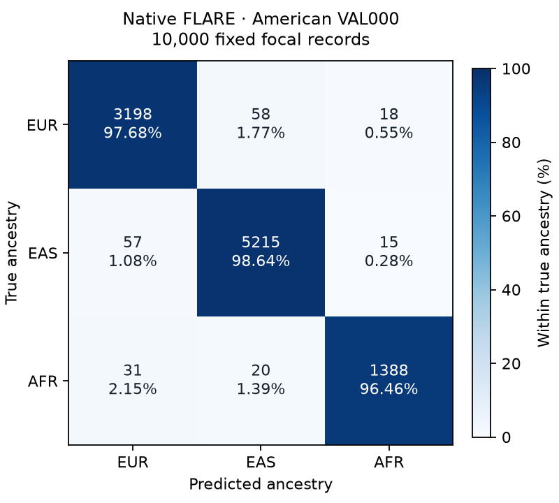

# First American native FLARE score

Actual new CPU score and final storage guard completed, external tool3050 returned0. Original sealed calls were not rerun or modified. The older seal outer tool/final guard remain UNKNOWN.

- Parent: american_c3_val_000, one original full30Mb validation simulation.
- Observed panel:1600haplotypes,600reference and1000query haplotypes.
- Support: all10000 fixed common focal records, nearest native marker midpoint projection.
- Method: author FLAREv0.6.0 release, original AN1/AN2 calls carried as one-hot vectors.
- Accuracy: **98.0100%**. Macro F1: **97.7151%**.

| Population | Precision % | Recall % | F1 % | True focal records |
|---|---:|---:|---:|---:|
| EUR | 97.3220 | 97.6787 | 97.5000 | 3274 |
| EAS | 98.5264 | 98.6382 | 98.5822 | 5287 |
| AFR | 97.6777 | 96.4559 | 97.0629 | 1439 |

Confusion counts, true ancestry in rows and predicted ancestry in columns:

| True / predicted | EUR | EAS | AFR |
|---|---:|---:|---:|
| EUR | 3198 | 58 | 18 |
| EAS | 57 | 5215 | 15 |
| AFR | 31 | 20 | 1388 |

The unit is one prespecified focal record. This is not physical-span accuracy and no between-parent or training-seed SD exists for this single result. The dependent focal records do not justify treating10000 as independent biological replicates. It is a common-data native reconstruction, not literal ARGformer Table1 reproduction. Our American GNN and native ARGformer predictions are still pending, so no head-to-head ranking exists. The fixed600-update GNN training schedule is unchanged by this baseline VAL result.

The unchanged common evaluator verified every prediction identity, coordinate, parent and class/probability row before opening external truth. No probability floor, ANP renormalization, post-outcome eligibility change or new prediction generation was used.

[Actual completed score](../../../experiments/results/FLARE_C3_VAL000_common_score_H020980_20261016_v1/completed.json) · [New terminal proof](actual_tool_terminal.root_v1.json) · [Independent source review](../FLARE_VAL000_fresh_score_independent_review_20261016_v1/REPORT.md).

[Vector PDF](confusion_native_FLARE_VAL000.pdf) · [Editable SVG](confusion_native_FLARE_VAL000.svg).
